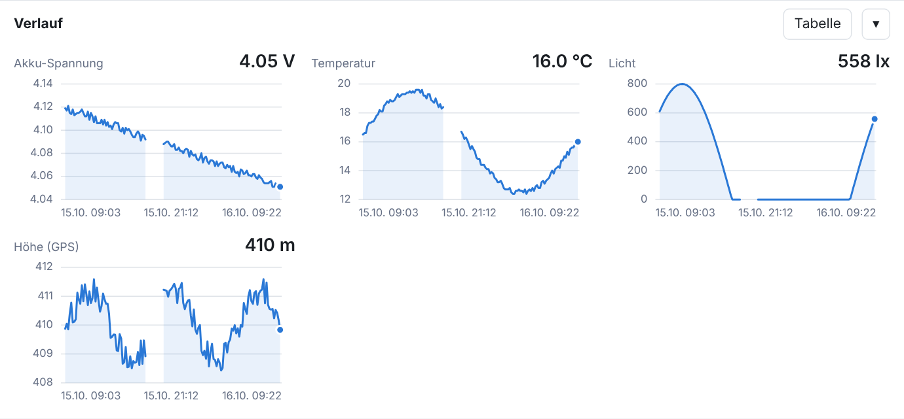

# MeshTracker

**Self-hosted map for [MeshCore](https://meshcore.co.uk) GPS trackers.** MeshTracker connects to your
MeshCore node as a companion client, asks your tracker for its telemetry at a fixed interval, and plots
the GPS position as a track on a map – together with battery, temperature, light, altitude and every other
sensor value the tracker reports. It runs in Docker and works either **through
[MeshMonitor](https://github.com/Yeraze/meshmonitor)** (its MeshCore Virtual Node) or **directly** against
a WiFi/USB companion node.

🇩🇪 [Deutsche Version](README.de.md)


<sub>Demo data from the built-in simulator.</sub>

## Why

Position and sensor data from a MeshCore tracker arrive as *telemetry* (Cayenne LPP) when you request it
over the mesh. Tools such as MeshMonitor store these values, but do not draw the GPS position from a
telemetry reply on a map. MeshTracker polls the tracker itself and does exactly that.

## Features

- **Map track** from GPS telemetry; positions from adverts are shown as separate hollow dots and never
  connect the line; GPX export
- **Polling interval per tracker** (default 10 min) plus a *Poll now* button
- **Path → flood fallback:** if the stored path is dead, MeshTracker resets it and retries by flood
  immediately. Optional *Always flood* mode for moving trackers
- **History charts** for every value the tracker sends (battery voltage, temperature, light,
  pressure, GPS altitude, …): one small chart per value, hover/keyboard values, table view, gaps stay gaps
- **Poll log** that says which way was used, how long it took and *why* a request failed
- Light/dark theme, mobile friendly, optional password protection, SQLite in a Docker volume

## Requirements

- A Linux machine (or anything) with **Docker + Docker Compose**
- A **MeshCore companion node** you can reach – via MeshMonitor, WiFi (TCP) or USB
- A MeshCore **tracker with GPS** (developed with a SenseCAP T1000-E) that allows telemetry requests
  (see [Tracker prerequisites](#tracker-prerequisites))

## Quick start

```bash
git clone https://github.com/20Bosko07/meshtracker.git
cd meshtracker
cp .env.example .env
nano .env                     # set MT_HOST and MT_PORT (see "Connecting")
docker compose up -d --build
```

Open **http://\<server\>:8282**. The badge at the top left turns green (“Node connected”) when the
connection works. Then click **+ Add tracker**, pick your tracker from the node's
contacts (or paste its 64-character public key), choose an interval, done.

No radio hardware? `MT_TRANSPORT=sim docker compose up --build` starts a simulated tracker whose path
“dies” from time to time so you can watch the flood fallback.

## Connecting

A MeshCore companion node accepts **one client at a time**. Pick the setup that matches yours:

### A) Through MeshMonitor (recommended if you already run it)

MeshMonitor owns the connection to your node and offers a **MeshCore Virtual Node**: a TCP server that
lets further companion clients share that node. MeshTracker connects there like a normal companion app.

1. In MeshMonitor, enable the **Virtual Node** for your MeshCore source and note its **port**.
2. If MeshMonitor runs in Docker, **publish that port** in MeshMonitor's own `docker-compose.yml`
   (`ports:` → `"7555:7555"`, use your port) and run `docker compose up -d` there.
3. In MeshMonitor allow **admin commands** on the Virtual Node (`allowAdminCommands` in its code).
   Without it MeshMonitor does not pass *reset path* through; telemetry still works, but the
   path→flood fallback cannot reset the path (the poll log then says “Path reset failed”).
4. In `.env`: `MT_TRANSPORT=tcp`, `MT_HOST=<IP of the MeshMonitor machine>` (not `localhost` – the
   connection is made from inside the container), `MT_PORT=<Virtual Node port>`.
5. In MeshMonitor, **turn off its own periodic telemetry retrieval for the tracker** – two pollers
   compete for the same node and airtime.

Notes:
- The **web UI port** of MeshMonitor (e.g. 8080) is *not* the Virtual Node port.
- The Virtual Node has **no authentication**. Publishing its port exposes it to your whole LAN. If you
  don't want that, put MeshTracker and MeshMonitor into the same Docker network and use the
  container name as `MT_HOST` (not tested by the author, standard Docker networking).
- MeshTracker tries MeshCore's current binary telemetry request first and automatically falls back to
  the older command for MeshMonitor versions that don't support it.

### B) Directly via WiFi (TCP)

Flash the **WiFi companion** firmware on your node and set `MT_TRANSPORT=tcp`, `MT_HOST=<node IP>`,
`MT_PORT=5000`. Nothing else may be connected to the node at the same time (MeshMonitor, phone app, …).
For a direct connection you can lower the wait times to `MT_PATH_TIMEOUT=10`, `MT_FLOOD_TIMEOUT=25`.

### C) Directly via USB (serial)

```bash
# .env:  MT_TRANSPORT=serial   MT_SERIAL_PORT=/dev/ttyACM0
docker compose -f docker-compose.yml -f docker-compose.serial.yml up -d --build
```

The serial override passes the device into the container and adds the `dialout` group. BLE is not
supported.

> Direct WiFi/USB connections are covered by automated tests against an emulated companion, but have not
> been verified on real hardware by the author. Feedback is welcome.

## Tracker prerequisites

A MeshCore node only answers telemetry requests if its owner allows it:

- In the tracker's settings, allow telemetry for **base** (battery), **location** and
  **environment** (sensors). The modes are *allow all* or *allow per contact flags*; with the latter the
  node that asks must be a contact with the matching telemetry permissions.
- The tracker needs a **GPS fix**. Without one it answers without a position – MeshTracker then shows
  “Reply without GPS position” instead of plotting a wrong point.
- The tracker must be a **contact on your node** (the node has to have heard its advert).

Which sensors show up is decided by the tracker, not by MeshTracker: every value in the reply is stored
and charted automatically.

## Using it

- **Routing** (per tracker, *Edit*):
  - *Auto* – first try the path stored on the node. If there is no answer in time, the path is reset
    and the request is repeated by flood (up to `MT_FLOOD_RETRIES` times).
  - *Always flood* – reset the path before every poll. Most reliable for a tracker that moves; costs a
    little more airtime.
- **Interval:** every poll sends 1–3 radio requests. Intervals under 5 minutes load the mesh (duty
  cycle) and are meant for testing only.
- **Poll log** (expand on the tracker card): time, route, duration and reason of each attempt.
- **Time range** (top right) applies to the map track and the charts; the table view lists the same
  values. GPX export uses the same range.

## Configuration

Set in `.env` (see [`.env.example`](.env.example)):

| Variable | Default | Meaning |
|---|---|---|
| `MT_WEB_PORT` | `8282` | Port of the web interface on the host |
| `MT_TRANSPORT` | `tcp` | `tcp`, `serial` or `sim` |
| `MT_HOST` / `MT_PORT` | – / `5000` | Target for `tcp` (IP, not `localhost`) |
| `MT_SERIAL_PORT` / `MT_SERIAL_BAUD` | `/dev/ttyACM0` / `115200` | for `serial` |
| `MT_AUTH_USER` / `MT_AUTH_PASSWORD` | – | HTTP Basic protection (set both) |
| `MT_TILE_URL` / `MT_TILE_ATTRIBUTION` / `MT_TILE_MAX_ZOOM` | OpenStreetMap / `19` | Map tiles, e.g. your own tile server |
| `MT_FLOOD_RETRIES` | `2` | Flood retries after a request got no answer |
| `MT_PATH_TIMEOUT` / `MT_FLOOD_TIMEOUT` | `48` / `48` | Minimum wait per attempt (s). 48 is needed behind MeshMonitor's Virtual Node (it waits up to 45 s itself); 10 / 25 are enough for a direct connection |
| `MT_FLOOD_BACKOFF` | `5` | Pause between flood retries (s) |
| `MT_MIN_SPACING` | `10` | Minimum gap between two radio requests (s) |
| `MT_FAIL_RETRY` | `180` | Retry sooner after a failed round (s) |
| `MT_ADVERT_SYNC` | `60` | How often the node's contact list is checked for new advert positions (s; local, no radio traffic) |
| `MT_LOG_LEVEL` | `INFO` | Log level |

## Troubleshooting

What the interface and the poll log tell you, and what it means:

| What you see | Meaning / fix |
|---|---|
| Badge **Node not connected**, log `Connect call failed … Connection refused` | Nothing listens on `MT_HOST:MT_PORT`. Check IP/port; with MeshMonitor in Docker the Virtual Node port must be published. Test: `nc -zv <host> <port>` from the server |
| `No response from the MeshCore node (wrong host/port?)` | The port is open but it is not a MeshCore companion port (e.g. MeshMonitor's web UI port) |
| `Request refused (ERR_CODE_BAD_STATE)` | MeshMonitor refuses transmitting, e.g. the source is in *receive-only* mode |
| `Request refused (ERR_CODE_UNSUPPORTED_CMD)` | The node/Virtual Node does not know the command. MeshTracker switches to the older command by itself; if it persists, update MeshMonitor |
| `No reply after 3 attempts (…)` | The request went out but the tracker did not answer: out of range, telemetry not allowed, or two pollers colliding (turn off MeshMonitor's own retrieval for this tracker) |
| `Reply without GPS position` | The tracker answered but has no GPS fix, or location telemetry is not allowed |
| `Tracker is not in the node's contact list` | The node has not heard the tracker's advert yet – wait for one or add the contact on the node |
| `Path reset failed` | MeshMonitor's Virtual Node does not allow admin commands (see *Connecting → A*, step 3) |
| `port is already allocated` on `docker compose up` | Port 8282 is in use – set another `MT_WEB_PORT` in `.env` |
| Map is grey | The browser cannot reach the tile server (internet access, or `MT_TILE_URL`) |

`docker compose logs --tail 50` shows connection problems with the prefix `meshtracker.link`.

## Security

- The interface shows **where your tracker is**. Do not expose it to the internet without protection:
  set `MT_AUTH_USER` / `MT_AUTH_PASSWORD` and put it behind HTTPS (reverse proxy such as Caddy or
  nginx). HTTP Basic over plain HTTP sends the password unencrypted.
- A MeshMonitor Virtual Node has no authentication (see above) – keep it inside a trusted network.
- The map tiles are loaded by your *browser* from the tile provider (OpenStreetMap by default).
  Respect their [tile usage policy](https://operations.osmfoundation.org/policies/tiles/) or use your
  own provider.

## Update / backup / uninstall

```bash
git pull && docker compose up -d --build        # update (your .env stays untouched)
docker run --rm -v meshtracker_meshtracker-data:/data -v "$PWD":/backup alpine \
  cp /data/meshtracker.db /backup/                # backup the database
docker compose down                              # stop (data stays in the volume)
docker compose down -v                           # stop and delete all data
```

## How it works

MeshTracker is a MeshCore companion client built on the
[`meshcore`](https://github.com/meshcore-dev/meshcore_py) Python library. For each tracker it sends a
telemetry request through your node, waits for the reply, decodes the Cayenne LPP payload (GPS +
sensors) and stores it in SQLite. A small FastAPI backend serves the Leaflet map and chart UI.
It listens to adverts for extra positions and keeps the node's contact list in sync before every poll,
because a Virtual Node does not announce path changes.

HTTP API (used by the UI): `GET /api/status`, `/api/config`, `/api/contacts`, `/api/trackers`,
`POST /api/trackers`, `PATCH|DELETE /api/trackers/{id}`, `POST /api/trackers/{id}/poll`,
`POST /api/trackers/{id}/reset-path`, `GET /api/trackers/{id}/track|series|polls|export.gpx`.

## Development

```bash
python -m venv .venv && . .venv/bin/activate
pip install -r requirements-dev.txt
pytest                                           # logic, API and end-to-end against a fake companion
MT_TRANSPORT=sim MT_DB_PATH=./dev.db uvicorn app.main:app_factory --factory --reload
```

See [CONTRIBUTING.md](CONTRIBUTING.md).

## Status and limitations

- Used with MeshMonitor's Virtual Node and a SenseCAP T1000-E tracker. Direct WiFi/USB connections:
  automated tests only (see above). No BLE.
- The interface is English only for now (a German translation of this README is in [README.de.md](README.de.md)).
- One companion node per MeshTracker instance.

## License and credits

[MIT](LICENSE). Third-party: [Leaflet](https://leafletjs.com) (BSD-2-Clause, bundled),
[meshcore_py](https://github.com/meshcore-dev/meshcore_py) (MIT), FastAPI (MIT), Uvicorn (BSD-3-Clause),
map data © [OpenStreetMap contributors](https://www.openstreetmap.org/copyright).
MeshTracker is an independent project and not affiliated with MeshCore or MeshMonitor.
